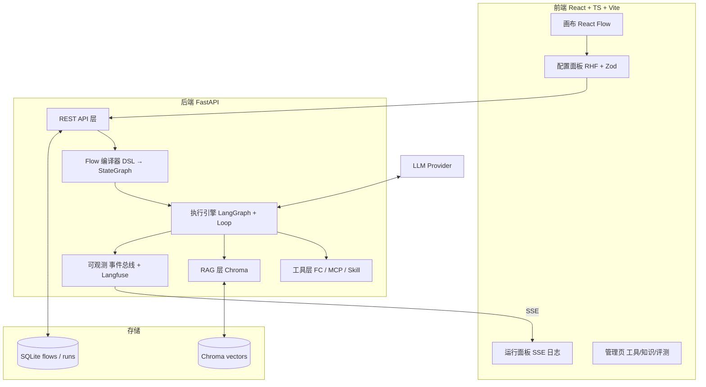

# AgentFlow Studio — Web 端 Agent 编排平台技术设计文档

> 版本：v1.0（设计稿） · 日期：2026-11-25
> 定位：本地单用户原型 · 画布编排 + 配置面板 · React + TypeScript + Vite
> 目标：跑通 **编排 → 执行 → 流式观测 → 评测** 的完整闭环，把 LLM API / Function Calling / Agent Loop / LangGraph / MCP / RAG / SSE / 评测这些核心技能串成一个真实项目。

---

## 1. 项目定位与范围

### 1.1 一句话定义

一个本地运行的 Web 应用：用户在画布上拖拽节点、连线定义执行拓扑，在右侧面板配置每个节点的参数，点击运行后实时看到模型思考、工具调用、中间结果和最终输出，并能用测试集对流程做回归评测。

### 1.2 核心能力映射（上一轮技能栈 → 平台模块）

| 技能点 | 在平台中的落点 | 第几阶段 |
|---|---|---|
| Python / FastAPI / asyncio | 后端 API 服务、SSE 流式推送 | P1 |
| LLM API / Token / 上下文 | LLM 节点封装、成本统计 | P1 |
| Prompt 工程 | Prompt 节点、System 消息模板管理 | P1 |
| Function Calling | Tool 节点，JSON Schema 参数校验 | P2 |
| Agent Loop / ReAct | 执行引擎的循环调度、步数上限 | P2 |
| LangGraph（State / 节点 / 条件边） | Flow DSL → LangGraph 编译层 | P2 |
| RAG（分块 / 向量库 / 召回重排） | Knowledge 节点、知识库管理页 | P3 |
| MCP 协议 | MCP Server 注册、工具动态发现 | P3 |
| Skill 编排 | Skill = 可复用子流程（Subgraph） | P3 |
| SSE / Docker | 流式运行日志、容器化部署 | P1 / P5 |
| 可观测 / 评测 / 安全 | 运行历史、评测集、人工审批节点 | P4 |

### 1.3 范围内 / 范围外

**范围内（v1 必须）**
- 流程的增删改查、画布编辑、JSON DSL 导入导出
- 8 类核心节点，支持串行、条件分支、并行
- 同步执行 + SSE 实时事件流
- 运行历史与单步日志回放
- 本地 SQLite 持久化
- 基础评测集（20 条以内）与一键回归

**范围外（明确不做）**
- 登录、多用户、权限、租户隔离
- 计费、配额、审计
- 分布式调度、多机部署
- 模型微调

---

## 2. 技术选型

### 2.1 前端

| 层次 | 选型 | 理由 | 备选 |
|---|---|---|---|
| 框架 | React 18 + TypeScript | 与学习路径一致，类型安全 | — |
| 构建 | Vite 6 | 冷启动快，HMR 体验好 | — |
| 画布 | `@xyflow/react`（React Flow 12） | 节点/边/连线/缩放开箱即用，社区大 | 自研 SVG（不推荐） |
| 状态 | Zustand | 轻量，画布频繁更新不易卡顿 | Jotai |
| UI | Tailwind CSS + shadcn/ui | 组件可定制，样式不打架 | Ant Design |
| 表单 | React Hook Form + Zod | 与后端 Pydantic Schema 对齐 | — |
| 流式 | `@microsoft/fetch-event-source` | 支持 POST + 断线重连 | 原生 EventSource（仅 GET） |
| 路由 | React Router v7 | — | — |

### 2.2 后端

| 层次 | 选型 | 理由 | 备选 |
|---|---|---|---|
| 语言 | Python 3.11+ | 生态首选，`asyncio` 原生 | — |
| Web 框架 | FastAPI | 异步、自动 OpenAPI、SSE 友好 | — |
| 数据校验 | Pydantic v2 | Schema 即文档，前后端可对齐 | — |
| 编排引擎 | LangGraph | 状态显式、支持循环/断点/人工审批 | 手写 Loop（P2 前先手写一遍） |
| LLM SDK | `langchain-openai` / `openai` | 统一接口，便于换模型 | — |
| 工具协议 | MCP Python SDK + FastMCP | 2026 年事实标准 | 手写 Function Calling |
| 数据库 | SQLite + `aiosqlite` | 零部署，原型足够 | PostgreSQL |
| 向量库 | Chroma（本地持久化） | 嵌入简单，单文件存储 | Qdrant / Milvus |
| 可观测 | Langfuse 自托管（可选） | 链路追踪 + 成本统计 | 自建日志表 |

### 2.3 选型理由中的关键权衡

- **为什么先手写 Agent Loop 再上 LangGraph**：框架把循环藏起来了，而面试和调试考的都是循环本身。P2 阶段先用第 6 章那段裸循环跑通，P3 再迁到 LangGraph，迁移成本很低但理解深度差别很大。
- **为什么 SQLite 起步**：单用户原型的瓶颈不在数据库，早换 PostgreSQL 只会增加 Docker Compose 复杂度。表结构按可迁移设计（不用 SQLite 专有语法）。
- **为什么用 React Flow 而不是自研画布**：拖拽、连线、框选、缩放、MiniMap 这些自研至少两周，且容易在交互细节上翻车。它的 `nodeTypes` 注册机制正好对应我们的节点注册表设计。

---

## 3. 整体架构



### 3.1 分层职责

| 层 | 职责 | 不做什么 |
|---|---|---|
| API 层 | 校验、CRUD、触发执行、SSE 推送 | 不含编排逻辑 |
| 编译器 | 把 Flow DSL 校验并转换为 LangGraph StateGraph | 不执行 |
| 执行引擎 | 节点调度、状态流转、重试、超时、步数上限 | 不认识 HTTP |
| 工具层 | 统一 Tool 接口，屏蔽 FC / MCP / Skill 差异 | 不管调度 |
| 可观测 | 收集事件、落库、推 SSE | 不改变执行 |

---

## 4. 核心数据模型

### 4.1 Flow DSL（前后端共用契约）

一份流程就是一个 JSON。前端画布状态与后端存储是同一个结构，避免双向转换。

```typescript
// 前端 types/flow.ts
export type NodeType =
  | 'input' | 'llm' | 'prompt' | 'tool' | 'mcp'
  | 'skill' | 'knowledge' | 'condition' | 'loop' | 'human' | 'output';

export interface FlowNode {
  id: string;
  type: NodeType;
  position: { x: number; y: number };
  config: Record<string, unknown>;  // 由节点 Schema 校验
}

export interface FlowEdge {
  id: string;
  source: string;
  target: string;
  sourceHandle?: string;  // condition 的 true/false 分支
}

export interface Flow {
  id: string;
  name: string;
  version: number;
  nodes: FlowNode[];
  edges: FlowEdge[];
  createdAt: string;
  updatedAt: string;
}
```

```python
# 后端 app/models/flow.py —— 与前端契约逐字段对齐
from pydantic import BaseModel, Field
from typing import Literal, Any

NodeType = Literal[
    "input", "llm", "prompt", "tool", "mcp",
    "skill", "knowledge", "condition", "loop", "human", "output",
]

class FlowNode(BaseModel):
    id: str
    type: NodeType
    position: dict[str, float]
    config: dict[str, Any] = Field(default_factory=dict)

class FlowEdge(BaseModel):
    id: str
    source: str
    target: str
    source_handle: str | None = None

class Flow(BaseModel):
    id: str
    name: str
    version: int = 1
    nodes: list[FlowNode]
    edges: list[FlowEdge]
```

### 4.2 执行实例

```python
class RunStatus(StrEnum):
    PENDING = "pending"
    RUNNING = "running"
    WAITING_HUMAN = "waiting_human"
    SUCCEEDED = "succeeded"
    FAILED = "failed"
    CANCELLED = "cancelled"

class Run(BaseModel):
    id: str
    flow_id: str
    flow_version: int
    status: RunStatus
    inputs: dict[str, Any]
    outputs: dict[str, Any] | None
    state: dict[str, Any]          # 完整 GraphState 快照，支持断点续跑
    error: str | None
    token_usage: int = 0
    cost_estimate: float = 0.0
    started_at: str | None
    finished_at: str | None

class RunEvent(BaseModel):
    id: str
    run_id: str
    seq: int                       # 单调递增，前端按 seq 排序去重
    type: Literal[
        "run_started", "node_started", "node_completed",
        "token", "tool_call", "tool_result",
        "human_required", "run_completed", "run_failed",
    ]
    node_id: str | None
    payload: dict[str, Any]
    created_at: str
```

### 4.3 数据库表（SQLite）

| 表 | 主键 | 关键字段 | 说明 |
|---|---|---|---|
| `flows` | id | name, version, dsl_json, created_at, updated_at | 流程定义 |
| `runs` | id | flow_id, status, inputs_json, outputs_json, state_json, token_usage, cost | 执行记录 |
| `run_events` | (run_id, seq) | type, node_id, payload_json, created_at | 事件流，SSE 与回放共用 |
| `tools` | id | name, kind(fc/mcp), schema_json, endpoint, enabled | 工具注册 |
| `mcp_servers` | id | name, transport(stdio/sse), command_or_url, enabled | MCP 服务注册 |
| `knowledge_bases` | id | name, collection, chunk_size, embedding_model | 知识库元数据 |
| `eval_sets` | id | name, cases_json, rubric_version, created_at | 评测集（含 Case 定义与裁判版本） |
| `eval_results` | id | set_id, flow_version, metrics_json, created_at | 评测结果（含 pass^k 与成本指标） |
| `eval_trials` | (result_id, case_id, trial) | outcome_ok, tool_ok, judge_score, steps, tokens, cost, trace_ref | 每次运行的明细，支持一致性分布分析 |

---

## 5. 节点类型设计

每个节点遵循统一契约：**输入 schema → 执行 → 输出 schema**，配置面板由节点的 config schema 动态生成，新增节点只需要注册一次。

### 5.1 节点清单

| 节点 | 图标语义 | 配置项 | 输入 | 输出 | 实现要点 |
|---|---|---|---|---|---|
| `input` | 入口 | 变量名、类型、默认值 | — | 变量表 | 流程必须有且仅有一个 |
| `llm` | 模型 | model、temperature、system、max_tokens | 变量表 | `text`, `tool_calls` | 流式 token 推 SSE |
| `prompt` | 模板 | 模板字符串、变量插值 | 变量表 | `text` | Jinja2 风格 `{{var}}` |
| `tool` | 工具 | tool_id、参数映射、超时、重试次数 | 变量表 | `result` | JSON Schema 强校验 + 异常降级 |
| `mcp` | MCP | server_id、tool_name、参数映射 | 变量表 | `result` | 运行时动态发现工具列表 |
| `skill` | 子流程 | flow_id、输入映射 | 变量表 | 子流程输出 | 编译为 LangGraph Subgraph |
| `knowledge` | 知识 | kb_id、top_k、重排开关 | query | `context` | 召回结果注入下游 prompt |
| `condition` | 分支 | 表达式（如 `{{score}} > 0.8`） | 变量表 | 走 true/false 分支 | 对应条件边，两个 sourceHandle |
| `loop` | 循环 | 最大轮次、退出条件 | 变量表 | 每轮变量 | 步数上限强制，防跑飞 |
| `human` | 人工 | 审批提示、超时时间 | 变量表 | 审批结果 | 挂起 Run，等待 API 回调 |
| `output` | 出口 | 输出字段映射 | 变量表 | 最终 outputs | 流程终止节点 |

### 5.2 节点注册机制（关键设计）

新增节点不需要改画布代码。每个节点模块导出一个描述对象：

```typescript
interface NodeDefinition {
  type: NodeType;
  label: string;
  category: '基础' | '模型' | '工具' | '控制';
  color: string;
  configSchema: RJSFSchema;      // 驱动右侧配置面板自动生成表单
  defaultConfig: Record<string, unknown>;
  inputs: string[];              // 入变量名
  outputs: string[];             // 出变量名
}

// 启动时注册，画布左侧组件库遍历 registry 渲染
registry.register(llmNode);
registry.register(toolNode);
```

后端同样有一份注册表，负责把 `config` 用 Pydantic 模型校验——**前后端共用 JSON Schema 是避免配置漂移的关键**。

---

## 6. 执行引擎设计

### 6.1 先手写 Loop，再上 LangGraph

P2 阶段的裸循环（面试高频，务必手写一遍）：

```python
MAX_STEPS = 8

def run_agent(messages, tools, max_steps=MAX_STEPS):
    for step in range(max_steps):
        resp = llm.chat(messages, tools=tools)
        if not resp.tool_calls:
            return resp.text
        messages.append(resp)
        for call in resp.tool_calls:
            try:
                args = validate(call.name, call.arguments)   # Pydantic 校验
                result = dispatch(call.name, args)           # 统一工具分发
            except Exception as e:
                result = f"工具执行失败：{e}"                # 异常作为结果回写
            messages.append(tool_message(call.id, result))
    raise StepLimitExceeded("超过步数上限")                  # 防无限循环
```

**验证手段**：
1. 正常问一个问题 → 应正确调用工具并返回结果。
2. `max_steps=1` 问需要两轮的问题 → 应抛 `StepLimitExceeded`。
3. 故意传错参数 → 应返回"工具执行失败"而不是让进程崩掉。

### 6.2 Flow DSL → LangGraph 编译

```python
def compile_flow(flow: Flow) -> StateGraph:
    graph = StateGraph(AgentState)
    for node in flow.nodes:
        graph.add_node(node.id, make_node_fn(node))   # 注册表查执行函数
    for edge in flow.edges:
        if edge.source_handle:  # condition 分支
            graph.add_conditional_edges(
                edge.source,
                lambda s, h=edge.source_handle: route(s, h),
                [edge.target],
            )
        else:
            graph.add_edge(edge.source, edge.target)
    graph.set_entry_point(find_input_node(flow).id)
    graph.set_finish_point(find_output_node(flow).id)
    return graph.compile(checkpointer=SqliteSaver(...))
```

`AgentState` 至少包含：`variables`（节点间传递）、`messages`（对话上下文）、`step_count`、`token_usage`、`cost`、`current_node`。

### 6.3 可靠性机制

| 机制 | 实现 | 目的 |
|---|---|---|
| 步数上限 | `MAX_STEPS=8`，循环节点独立上限 | 防无限循环烧钱 |
| 超时 | 每个工具节点 `asyncio.wait_for` | 防单个工具卡死 |
| 重试 | 指数退避，默认 2 次 | 应对接口抖动 |
| 幂等 | tool_call_id 作幂等键 | 重试不重复扣费/下单 |
| 断点续跑 | LangGraph checkpointer 存 GraphState | 人工审批后继续、失败重跑 |
| 人工审批 | `human` 节点挂起 Run，状态置 `WAITING_HUMAN` | 高危操作兜底 |

---

## 7. API 设计

### 7.1 REST 端点

| 方法 | 路径 | 说明 |
|---|---|---|
| GET / POST | `/api/flows` | 列表 / 创建 |
| GET / PUT / DELETE | `/api/flows/{id}` | 详情 / 更新 / 删除 |
| POST | `/api/flows/{id}/validate` | 校验 DSL（环检测、孤立节点、必填项） |
| POST | `/api/flows/{id}/run` | 触发执行，返回 `run_id` |
| GET | `/api/runs/{id}` | 执行详情与最终输出 |
| GET | `/api/runs/{id}/events` | **SSE 事件流**，实时日志 |
| POST | `/api/runs/{id}/resume` | 人工审批后继续 |
| POST | `/api/runs/{id}/cancel` | 取消执行 |
| CRUD | `/api/tools`, `/api/mcp-servers`, `/api/knowledge-bases` | 资源管理 |
| POST | `/api/knowledge-bases/{id}/ingest` | 文档入库（分块 + 向量化） |
| CRUD | `/api/eval-sets` | 评测集管理 |
| POST | `/api/eval-sets/{id}/run` | 跑评测集，参数 `repeats=k`，返回指标与 trial 明细 |
| POST | `/api/runs/{id}/to-case` | **失败 Run 一键转 Case**（评测集从真实失败中生长） |
| POST | `/api/eval/compare` | 两次评测结果对比（按 flow_version / prompt 版本） |
| GET | `/api/eval-sets/{id}/report` | 导出 HTML/JSON 报告，含准确率 vs 成本曲线 |

### 7.2 SSE 事件协议

```
event: node_started
data: {"seq":7,"run_id":"r_123","node_id":"llm_1","payload":{"model":"gpt-4o-mini"}}

event: token
data: {"seq":8,"run_id":"r_123","node_id":"llm_1","payload":{"text":"你好"}}

event: tool_call
data: {"seq":9,"run_id":"r_123","node_id":"tool_2","payload":{"name":"get_weather","args":{"city":"北京"}}}

event: run_completed
data: {"seq":15,"run_id":"r_123","payload":{"outputs":{"answer":"..."},"tokens":428,"cost":0.0021}}
```

前端按 `seq` 排序去重，断线重连时带 `Last-Event-ID` 从断点续推。服务端用 `asyncio.Queue` 做事件总线，执行引擎写入，SSE 路由读出。

---

## 8. 前端设计

### 8.1 页面结构

| 页面 | 路由 | 核心内容 |
|---|---|---|
| 流程列表 | `/flows` | 卡片网格，新建 / 复制 / 导入导出 JSON |
| 编辑器 | `/flows/:id` | 三栏：左侧节点库 / 中间画布 / 右侧配置面板 + 底部运行抽屉 |
| 运行历史 | `/runs` | 表格 + 状态筛选，点击看事件回放 |
| 工具管理 | `/tools` | FC 工具与 MCP Server 注册、启停 |
| 知识库 | `/knowledge` | 上传文档、分块参数、召回测试 |
| 评测 | `/eval` | 评测集管理、一键回归、指标对比 |

### 8.2 编辑器三栏布局

```
┌─────────┬────────────────────────────┬───────────────┐
│ 节点库   │        画布                 │ 配置面板       │
│ 基础     │   [input] → [llm]          │ 动态表单       │
│ 模型     │              ↓             │ (configSchema) │
│ 工具     │         [condition]        │               │
│ 控制     │        ↙        ↘          │ 校验错误提示   │
│         │     [tool]     [output]     │               │
├─────────┴────────────────────────────┴───────────────┤
│ 运行抽屉：实时日志 / token 流 / 工具调用 / 成本       │
└───────────────────────────────────────────────────────┘
```

### 8.3 Zustand Store 结构

```typescript
interface FlowStore {
  flow: Flow;
  selectedNodeId: string | null;
  validationErrors: Record<string, string>;
  run: { status: RunStatus; events: RunEvent[]; activeNodeId: string | null };

  addNode: (type: NodeType, position: XYPosition) => void;
  updateConfig: (nodeId: string, patch: Record<string, unknown>) => void;
  onConnect: (edge: Connection) => void;
  validate: () => Promise<boolean>;
  startRun: () => Promise<void>;
  appendEvent: (event: RunEvent) => void;
}
```

### 8.4 关键交互

1. **拖拽添加**：左侧节点项 `onDragStart` 写 `dataTransfer`，画布 `onDrop` 用 `screenToFlowPosition` 定位。
2. **配置面板**：根据选中节点的 `configSchema` 用 RJSF（或自研 schema 渲染器）生成表单；`onChange` 即时写回 store 并做 Zod 校验。
3. **运行实时日志**：`fetchEventSource('/api/runs/{id}/events')`，按事件类型渲染不同颜色标签；`token` 事件流式追加到输出区。
4. **DSL 导入导出**：画布状态即 Flow JSON，导出下载 / 导入校验后替换 store。

---

## 9. RAG / MCP / Skill 集成

### 9.1 RAG 链路

```
上传文档 → 分块(chunk_size=500, overlap=50) → Embedding → Chroma 持久化
查询 → 向量召回(top_k=4) → 可选 rerank → 注入 knowledge 节点 context
```

验证：用 5 份本地 Markdown 建库，问一个只有文档里才有的细节，检查召回是否命中；关闭 rerank 对比一次效果。

### 9.2 MCP 集成

- **先消费再生产**：在平台里接入一个现成 MCP Server（如文件系统），观察工具动态发现。
- **再生产**：用 FastMCP 把平台里的一个内部 API 包成 MCP Server，让任意合规 Agent 能调用。
- **安全**：工具描述视为不可信数据；高危工具调用前走 `human` 节点审批；权限最小化。

### 9.3 Skill（可复用子流程）

定位：**Tool/MCP 提供原子操作，Skill 编排多个工具完成完整业务目标**。
实现上把某个 Flow 编译成 LangGraph Subgraph，作为 `skill` 节点嵌入父流程。参数映射用 JSONPath，强校验输入，避免模型乱传参导致链路雪崩。

---

## 10. 可观测、评测与安全

### 10.1 可观测

- 每个 `RunEvent` 落 `run_events` 表，同时推 SSE。
- 记录：节点耗时、token 用量、工具调用参数与结果、成本估算。
- 可选接 Langfuse 做更细的链路追踪（trace / span / score）。

### 10.2 评测体系（v1.1 扩充）

> 2026 年的共识：Agent 评测必须同时覆盖 **结果（Outcome）**、**轨迹（Trajectory）**、**系统（System）** 三层，且因为 Agent 的非确定性，必须多次运行取分布，而不是单次 pass/fail。传统单元测试的思路在这里是错的。

#### 10.2.1 五个核心原则

| 原则 | 做法 | 反例 |
|---|---|---|
| **多次运行** | 每个 case 跑 N=3~5 次，报告成功率 + pass^k | 跑一次通过就宣布 OK |
| **确定性优先** | 能用代码查的（工具名、参数 schema、DB 终态、单测）绝不用 LLM 裁判 | 花钱让 judge 数工具名 |
| **裁判只补位** | judge 只评代码评不了的主观维度，且必须人工校准 | judge 自己打分自己信 |
| **松轨迹匹配** | 查"必要工具覆盖 + 禁止工具零命中"，不查调用顺序 | 要求精确序列，惩罚更优路径 |
| **效率入指标** | 步数 / token / 延迟 / 每次成功成本与准确率同报 | +2% 准确率换 10 倍成本 |

**为什么必须多次运行**：τ-bench 数据显示，最强模型单次任务成功率不到 50%，但 pass^8（8 次独立试验全过）掉到 25% 以下。单次通过是噪声，不是信号。"3/5 通过"本身就是"这个任务不可靠"的发现，不该被平均掉。

#### 10.2.2 Case 与评分数据模型

```python
# app/eval/models.py
from pydantic import BaseModel
from typing import Any

class EvalCase(BaseModel):
    id: str
    input: dict[str, Any]
    expected_outcome: dict[str, Any] | None   # 终态断言，如 {"ticket.status": "closed"}
    required_tools: set[str] = set()          # 必须覆盖，不比对顺序
    forbidden_tools: set[str] = set()         # 零命中
    rubric: str = ""                          # 主观维度评分标准

class Score(BaseModel):
    case_id: str
    trial: int
    outcome_ok: bool
    tool_ok: bool
    judge_score: float | None                 # 仅主观维度，0-10
    steps: int
    tokens: int
    cost: float
```

#### 10.2.3 三层采集器

**A. 结果层（Outcome）** — 查最终状态，不轻信 Agent 的自述。机票 Agent 说"已预订"不算成功，数据库里存在订单才算。

```python
def check_outcome(final_state: dict, case: EvalCase) -> bool:
    if case.expected_outcome is None:
        return True
    return all(final_state.get(k) == v for k, v in case.expected_outcome.items())
```

**B. 轨迹层（Trajectory）** — 纯代码评分，复用 `run_events` 表，无需另造采集器。

```python
def grade_trajectory(events: list[RunEvent], case: EvalCase) -> bool:
    calls = [e for e in events if e.type == "tool_call"]
    used = {c.payload["name"] for c in calls}
    args_ok = all(validate_args(c) for c in calls)   # Pydantic Schema 校验
    return (
        case.required_tools <= used                  # 必要工具全覆盖
        and not (case.forbidden_tools & used)        # 禁止工具零命中
        and args_ok
    )
```

> 关键：`required_tools <= used` 是集合包含检查，不是序列比对。Agent 用更少的工具或不同的顺序达成目标应被判为通过。只有确实存在唯一正确路径的任务，才启用严格序列匹配。

**C. 系统层（System）** — 直接从 `runs` 表聚合：`steps`、`token_usage`、`cost`、`finished_at - started_at`。重点是**每次成功成本**（总成本 ÷ 成功次数），而不是裸 token 消耗。

#### 10.2.4 可靠性指标：pass^k

```python
def pass_power_k(trials: dict[str, list[bool]], k: int) -> float:
    """每个 case 跑 k 次，pass^k = 所有 case 全部通过的比例"""
    completed = {cid: results for cid, results in trials.items() if len(results) == k}
    return sum(all(run) for run in completed.values()) / len(completed)
```

报告示例（10 个 case × 3 次）：

| 指标 | 计算 | 用途 |
|---|---|---|
| 任务成功率 | 通过次数 ÷ 总次数 |  headline，但会高估可靠性 |
| pass^3 | 3 次全过的 case 占比 | **发布门禁主指标** |
| 工具调用正确率 | `tool_ok=True` 的 trial 占比 | **发布门禁主指标** |
| 一致性分布 | 每个 case 的通过次数直方图 | 定位"3/5 通过"的不稳定任务 |
| 每次成功成本 | 总成本 ÷ 成功次数 | 准确性 vs 成本 Pareto 判断 |

#### 10.2.5 LLM 裁判：只补位，且必须校准

```python
JUDGE_RUBRIC = """按以下维度打分并给出证据：
1. 任务完成 — 是否真正达成用户目标
2. 无幻觉 — 只引用真实存在的工具/文件/API
3. 推理有据 — 结论能追溯到工具返回结果
返回 JSON: {"score": int, "pass": bool, "evidence": [...]}
"""

def llm_judge(case: EvalCase, outcome: dict, trace: list) -> dict:
    return client.chat(
        model=JUDGE_MODEL,             # 与被评 agent 不同模型族
        temperature=0,                 # 冻结 judge 版本
        system=JUDGE_RUBRIC,
        messages=[{"role": "user", "content": format(case, outcome, trace)}],
    )
```

已知偏差与对策：

| 偏差 | 表现 | 对策 |
|---|---|---|
| Position bias | 偏好第一个/第二个回答 | 成对比较时 A/B 顺序随机化，跑两次取平均 |
| Verbosity bias | 偏好更长的回答 | rubric 中显式惩罚冗余，mask 模型身份 |
| Self-enhancement | 给自家模型打高分 | judge 用不同模型族，独立 context |
| 裁判漂移 | 同一 trace 分数随时间变化 | judge prompt / model / rubric / 输出格式一起版本化 |

**校准流程**：先让人工对 20 条样本打 10 分 → judge 打同样 20 条 → 逐条看分歧样本。分歧往往暴露的是 rubric 写得不够明确，而不是 judge 不行；修订 rubric 后重新校准。judge prompt 要当生产代码管理，改一个词就可能让整套分数漂移。

#### 10.2.6 评测集生命周期

1. **来源要真实**：从失败 Run 和线上日志里补 case（平台提供"失败 Run 一键转 Case"按钮），而不是凭空编教科书题。
2. **定期轮换**：静态评测集一旦被工程师反复优化，就会变成新的训练目标而失效。每个大版本轮换进新 case。
3. **Eval-driven development**：先写 eval 定义"能力达标"长什么样，再实现功能；让 eval 从低通过率开始，新模型发布时跑一遍就知道哪些 bet 兑现了。
4. **防饱和**：评测集长期 100% 说明它已失去区分度，要主动加难题。分数接近饱和时进步会很慢，但对数曲线上的小幅提升可能是真实的大能力跃迁——此时必须人工读 transcript 再下结论。

#### 10.2.7 工具选型（2026 格局）

| 工具 | 定位 | 许可证 / 状态 | 对本项目 |
|---|---|---|---|
| **DeepEval** | pytest 风格，自带 tool correctness / G-Eval / faithfulness | Apache-2.0，活跃 | ⭐ 首选，CI 门禁 + Python 栈契合 |
| **Langfuse** | 自托管可观测，dataset + trace + score | MIT 核心（2026-01 被 ClickHouse 收购，许可证不变） | ⭐ 可选，与 `run_events` 互补 |
| Promptfoo | CLI/YAML eval 矩阵 + 红队测试 | MIT（2026-03 加入 OpenAI，承诺保持开源） | 想要 eval 进 git 时用 |
| LangSmith | 与 LangGraph 集成最深 | SDK MIT，平台付费 | 原型阶段不必 |
| Ragas | RAG 专用指标 | Apache-2.0，但 2026-01 后未发版 | 新项目谨慎 |
| ~~openai/evals~~ | 旧开源库 | 托管版 2026-11-30 关停 | ❌ 不要选 |

**推荐组合**：先自建三层采集器（数据已经在 `run_events` 里，成本很低）+ DeepEval 做 CI 门禁；P4 之后如需更细的 trace 分析再接 Langfuse。不要一上来就买平台——工具只提供管道，能反映真实使用分布的 case 和反映用户真实关心的 rubric 是自己的活。

#### 10.2.8 发布门禁与平台侧增强

**门禁规则**（CI 里卡两个指标，其余只作回归信号）：

```python
PASS_THRESHOLD = 0.85
TOOL_OK_THRESHOLD = 0.95
K = 3

assert suite.task_success_rate >= PASS_THRESHOLD
assert suite.pass_power_k(K) >= 0.70
assert suite.tool_ok_rate >= TOOL_OK_THRESHOLD
assert suite.cost_per_success <= baseline_cost * 1.2   # 软门禁，告警不阻断
```

**平台侧三个具体增强**：
1. `run_events` 复用为评测 trace 源——不重复造采集器。
2. "失败 Run 一键转 Case"按钮——评测集从真实失败里生长。
3. `/api/eval/compare` 版本对比视图——改 prompt 前后指标并排，成本曲线同屏。

**验证手段**（新增）：
- 10 个 case 各跑 3 次 → 报告必须同时出现 `pass^3` 和一致性分布，不能只有单一成功率。
- 让 judge 与人工对同一批 20 条打分 → 分歧率 < 15%，且每个分歧都能定位到 rubric 条款；否则先修 rubric。
- 故意把一个 case 的 `forbidden_tools` 设成常用工具 → `tool_ok` 必须为 False，证明轨迹检查真在工作。
- 把 max_steps 调低一档跑全套 → 成功率下降但成本也下降，能画出 Pareto 曲线，证明效率指标被正确采集。

### 10.3 安全

| 风险 | 措施 |
|---|---|
| Prompt 注入 | 检索内容/工具输出当作数据而非指令；System Prompt 权限最高 |
| 工具越权 | 权限最小化；高危操作走 `human` 节点 |
| 无限循环 | `MAX_STEPS` + 循环节点独立上限 |
| 重复调用 | tool_call_id 幂等键 |
| 代码执行 | 沙箱隔离（原型阶段直接禁用代码执行节点） |

---

## 11. 部署方案

### 11.1 本地开发

```bash
# 后端
python -m venv .venv && source .venv/Scripts/activate   # Windows Git Bash
pip install -r requirements.txt
uvicorn app.main:app --reload --port 8000

# 前端（另一个终端）
npm install && npm run dev      # http://localhost:5173
```

Vite 配置 proxy 把 `/api` 转发到 `localhost:8000`。

### 11.2 Docker Compose（P5）

| 服务 | 镜像/构建 | 端口 | 说明 |
|---|---|---|---|
| frontend | 多阶段构建 + nginx | 3000 | 静态资源 |
| backend | Python 3.11 + uvicorn | 8000 | API + SSE |
| langfuse | langfuse/langfuse（可选） | 3001 | 可观测 |

SQLite 与 Chroma 数据挂 volume 持久化。

---

## 12. 开发路线图

| 阶段 | 交付物 | 验证标准 |
|---|---|---|
| **P1 骨架** | FastAPI + React 空壳，Flow CRUD，画布能增删节点连线，SSE 跑通 | 能保存一个流程并重新打开，画布状态不丢 |
| **P2 核心执行** | input / llm / prompt / condition / output 五类节点，手写 Agent Loop，SSE 实时日志 | 上一章三条 Loop 验证全部通过 |
| **P3 工具与知识** | tool / mcp / skill / knowledge 节点，RAG 建库与召回，MCP 接入一个现成 Server | 能跑通"查知识库 → 调工具 → 输出答案"的完整流程 |
| **P4 可靠与评测** | 重试/超时/幂等/人工审批，运行历史回放，三层采集器 + pass^k + LLM 裁判校准，20 条评测集与 CI 门禁 | 10 个 case × 3 次能出 `pass^3` 与一致性分布；judge 与人工分歧率 < 15%；异常场景不崩 |
| **P5 部署** | Docker Compose 一键起，README 与示例流程 | 新环境 `docker compose up` 可访问 |

---

## 13. 验收清单（汇总）

- [ ] 画布拖拽、连线、缩放、删除正常，刷新后流程不丢
- [ ] 配置面板按节点 schema 生成表单，错误配置有明确提示
- [ ] 点击运行后 SSE 实时推送 token / 工具调用 / 节点状态
- [ ] 手写 Agent Loop 三条验证（正常 / 步数上限 / 参数错误）全通过
- [ ] LangGraph 编译后条件分支正确，循环有上限
- [ ] RAG 能召回私有文档内容，MCP 能动态发现工具
- [ ] 人工审批节点能挂起并从断点续跑
- [ ] 评测集一键回归，输出成功率 / pass^k / 工具正确率 / 每次成功成本四项指标
- [ ] 同一 case 跑 3 次，报告能显示一致性分布而非单一 pass/fail
- [ ] LLM 裁判经人工校准，分歧样本可追溯到 rubric 条款
- [ ] 失败 Run 可一键转成评测 Case
- [ ] CI 门禁能阻断任务成功率与工具正确率的回归
- [ ] Docker Compose 一键启动

---

## 14. 待确认 / 可深入的点

1. **LLM 供应商**：默认 OpenAI 兼容接口？是否要顺便支持国内模型（DeepSeek / Qwen）的 base_url 切换？这会影响 LLM 节点配置形态。
2. **画布库授权**：`@xyflow/react` 的 Pro 功能（如协同）是否未来需要？原型阶段免费版够用。
3. **配置面板渲染**：用现成 RJSF 还是自己写 schema 渲染器？前者快，后者可控性强。建议先用 RJSF 跑通。
4. **评测工具落地**：先用自建三层采集器 + DeepEval 做 CI 门禁，还是直接上 Langfuse 自托管？见 10.2.7 的推荐组合。
5. **是否需要深入某一章**：比如第 6 章执行引擎、第 7 章 SSE 协议，可以继续展开到可直接编码的粒度。

> 这份文档是 v1.1 设计稿（10.2 评测体系已扩充）。接下来可以按阶段推进——建议从 P1 骨架开始，边写边把文档修正到与实际代码一致。

---

## 附：变更记录

| 版本 | 日期 | 变更 |
|---|---|---|
| v1.0 | 2026-11-25 | 初版：14 章完整技术设计 |
| v1.1 | 2026-11-25 | 扩充 10.2 评测体系（三层指标 / pass^k / LLM 裁判校准 / 工具选型 / 发布门禁）；同步更新 4.3 表结构、7.1 API 端点、P4 路线图、验收清单 |
